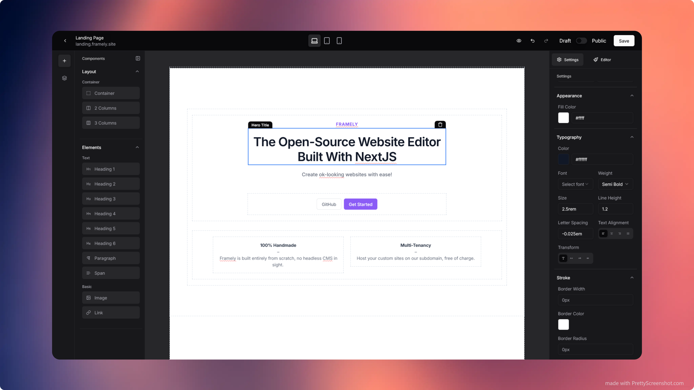

# Framely



Framely — full-stack заготовка конструктора сайтов с drag-and-drop редактором, мультитенантностью и поддержкой пользовательских доменов. Проект объединяет административную панель, визуальный редактор и серверную логику хранения страниц.

## ✨ Особенности
- Поддерживает drag-and-drop редактирование страниц.
- Имеет мультитенантную архитектуру с subdomain-подходом.
- Использует Clerk для аутентификации пользователей.
- Хранит данные через Prisma и MySQL.
- Подходит как стартовая база для собственного SaaS-конструктора сайтов.

## 🚀 Быстрый старт
### Требования
- Node.js
- MySQL
- заполненные ключи из `.env.example`

### Установка
```bash
npm install
```

### Подготовка окружения
Создайте файл `.env` на основе `.env.example` и заполните `DATABASE_URL`, `NEXT_PUBLIC_CLERK_PUBLISHABLE_KEY` и `CLERK_SECRET_KEY`.

### Запуск разработки
```bash
npm run dev
```

## 📁 Структура проекта
- `src` — клиентская и серверная логика редактора и панели управления.
- `prisma` — схема базы данных и настройки Prisma.
- `public` — статические изображения и демо-материалы.
- `package.json` — скрипты Next.js и генерации Prisma-клиента.
- `.env.example` — список обязательных переменных окружения.

## 🛠 Использование
### Локальный запуск
После запуска `npm run dev` приложение будет доступно на локальном Next.js-сервере.

### Что делает проект
Через интерфейс можно создавать сайты, редактировать страницы drag-and-drop способом и хранить данные страниц в MySQL через Prisma.

## 🧪 Технологии
- Next.js 15
- React 19
- TypeScript
- Prisma
- MySQL
- Clerk
- Tailwind CSS

Подпись относится к текущей версии проекта.

---

Автор: legenda  
Telegram: [@LEGENDA_SD](https://t.me/LEGENDA_SD)
